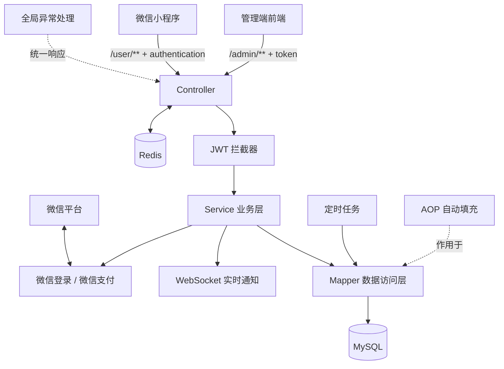

# Sky外卖（Sky Take Out）

Sky外卖是一个基于 Spring Boot 的餐饮外卖后端服务，面向「商家管理端」和「微信小程序用户端」提供 REST API。系统覆盖员工、分类、菜品、套餐、购物车、地址、订单、支付、经营统计等核心业务，并使用 Redis、WebSocket、定时任务和 Excel 导出等能力完善实际经营场景。

> 当前仓库只包含 Java 后端代码，不包含管理端前端、微信小程序前端和数据库初始化 SQL。运行前需要自行准备 `sky_take_out` 数据库及基础数据。

## 主要技术栈

版本号以项目 `pom.xml` 中的显式配置为准；未显式指定的依赖由 Spring Boot 2.7.3 的依赖管理统一控制。

| 技术                             | 版本                      | 用途                                                        |
| -------------------------------- | ------------------------- | ----------------------------------------------------------- |
| Java                             | 8                         | 项目运行基线；根 POM 未覆盖 Spring Boot Parent 的 Java 版本 |
| Maven                            | 3.x                       | 多模块构建与依赖管理                                        |
| Spring Boot                      | 2.7.3                     | 应用基础框架、自动配置和应用启动                            |
| Spring MVC                       | 由 Spring Boot 2.7.3 管理 | REST API、拦截器和 JSON 消息转换                            |
| MyBatis Spring Boot Starter      | 2.2.0                     | 数据访问层                                                  |
| MySQL Connector/J                | 由 Spring Boot 2.7.3 管理 | MySQL 数据库驱动                                            |
| Druid                            | 1.2.1                     | 数据库连接池                                                |
| PageHelper                       | 1.3.0                     | MyBatis 分页查询                                            |
| Spring Data Redis / Spring Cache | 由 Spring Boot 2.7.3 管理 | 店铺状态、菜品和套餐缓存                                    |
| Spring WebSocket                 | 由 Spring Boot 2.7.3 管理 | 新订单提醒和用户催单                                        |
| Knife4j                          | 3.0.2                     | Swagger API 文档                                            |
| JJWT                             | 0.9.1                     | 管理端、用户端身份认证                                      |
| AspectJ                          | 1.9.4                     | 公共字段自动填充                                            |
| Apache POI                       | 3.16                      | 经营数据 Excel 导出                                         |
| 微信支付 Apache HttpClient       | 0.4.8                     | 微信支付下单、查询和回调处理                                |
| 阿里云 OSS SDK                   | 3.10.2                    | 对象存储工具支持（当前未接入控制器）                        |
| Fastjson                         | 1.2.76                    | 第三方接口 JSON 处理                                        |
| Jackson Databind                 | 2.9.2                     | POJO 模块的 JSON 支持                                       |
| Lombok                           | 1.18.20                   | 简化实体、日志和构造代码                                    |
| Commons Lang                     | 2.6                       | 通用字符串等工具                                            |

## 项目功能

### 商家管理端

- 员工管理：登录、退出、新增、分页查询、启用/禁用、查看和修改员工。
- 分类管理：新增、分页查询、修改、删除、启用/停用菜品或套餐分类。
- 菜品管理：新增菜品及口味、分页查询、批量删除、修改、启售/停售。
- 套餐管理：维护套餐及其菜品关系，支持分页、批量删除、修改和启售/停售。
- 订单管理：条件检索、状态统计、查看详情、接单、拒单、取消、派送和完成订单。
- 店铺管理：设置和查询营业状态。
- 工作台：展示今日营业额、有效订单、订单完成率、用户数据，以及菜品、套餐和订单概览。
- 统计报表：营业额趋势、用户增长、订单统计、销量 Top 10，并可导出 Excel 经营报表。
- 实时提醒：通过 WebSocket 接收新订单和用户催单消息。

### 微信小程序用户端

- 微信登录：使用小程序授权码换取 `openid`，自动完成用户注册或登录。
- 店铺与商品浏览：查询营业状态、分类、在售菜品、口味、套餐及套餐明细。
- 购物车：添加商品、减少商品、查看和清空购物车。
- 地址簿：新增、修改、删除、查询地址并设置默认地址。
- 订单：提交订单、微信支付、查看历史订单与详情、取消订单、再来一单和催单。

### 系统能力

- 管理端和用户端使用两套 JWT 密钥、有效期和请求头名称。
- Redis 保存店铺营业状态并缓存菜品、套餐数据；后台变更数据时清理对应缓存。
- AOP 配合自定义 `@AutoFill` 注解，自动填写创建/更新时间及操作人。
- 全局异常处理统一封装业务异常响应，接口统一返回 `Result<T>`，分页统一返回 `PageResult`。
- 每分钟处理超过 15 分钟未支付的订单；每天凌晨 1 点处理派送中订单。
- 自定义 Jackson 转换器统一处理日期时间格式以及 Long 类型序列化。

## 整体架构



一次典型请求的处理链路为：客户端请求 → JWT 拦截器校验并将用户 ID 写入 `ThreadLocal` → Controller 参数接收 → Service 处理业务和事务 → Mapper 访问 MySQL → 返回统一 JSON 结果。缓存、实时通知、定时任务和第三方平台集成作为外围能力接入该主链路。

## 模块说明

```text
sky-take-out
├── pom.xml                 # 父工程：版本与模块管理
├── sky-common              # 公共模块
│   └── src/main/java/com/sky
│       ├── constant        # 常量
│       ├── context         # 当前用户 ThreadLocal 上下文
│       ├── exception       # 业务异常体系
│       ├── json            # Jackson 序列化配置
│       ├── properties      # JWT、微信、OSS 配置映射
│       ├── result          # 统一响应和分页结果
│       └── utils           # JWT、HTTP、微信支付、OSS 工具
├── sky-pojo                # 数据模型模块
│   └── src/main/java/com/sky
│       ├── entity          # 数据库实体
│       ├── dto             # 接口入参和业务传输对象
│       └── vo              # 接口展示对象
└── sky-server              # 可运行的服务模块
    └── src/main
        ├── java/com/sky
        │   ├── annotation  # 自动填充注解
        │   ├── aspect      # AOP 公共字段填充
        │   ├── config      # MVC、Redis、WebSocket 配置
        │   ├── controller  # admin、user、notify 接口
        │   ├── handler     # 全局异常处理
        │   ├── interceptor # 管理端和用户端 JWT 校验
        │   ├── mapper      # MyBatis Mapper 接口
        │   ├── service     # 业务接口及实现
        │   ├── task        # 订单定时任务
        │   └── websocket   # WebSocket 服务端
        └── resources
            ├── mapper      # MyBatis XML SQL
            ├── template    # Excel 导出模板
            ├── application.yml
            └── application-dev.yml
```

模块依赖关系如下：

```text
sky-server ──> sky-common
     │
     └──────> sky-pojo
```

## 数据模型

| 表              | 说明           |
| --------------- | -------------- |
| `employee`      | 管理端员工     |
| `user`          | 小程序用户     |
| `category`      | 菜品/套餐分类  |
| `dish`          | 菜品           |
| `dish_flavor`   | 菜品口味       |
| `setmeal`       | 套餐           |
| `setmeal_dish`  | 套餐与菜品关联 |
| `shopping_cart` | 用户购物车     |
| `address_book`  | 用户地址簿     |
| `orders`        | 订单主表       |
| `order_detail`  | 订单明细       |

> 仓库没有数据库建表及初始化脚本，表结构需与 `sky-pojo/entity`、Mapper 接口和 `resources/mapper` 中的 SQL 保持一致。

## 运行项目

### 1. 环境准备

- JDK 8
- Maven 3.x
- MySQL 5.7 或 8.x
- Redis 5.x 或更高版本
- 可选：微信小程序、微信支付商户、阿里云 OSS 相关账号和证书

### 2. 准备数据库

创建数据库：

```sql
CREATE DATABASE sky_take_out
  DEFAULT CHARACTER SET utf8mb4
  COLLATE utf8mb4_unicode_ci;
```

随后导入与上述数据模型匹配的表结构和基础数据。由于仓库不含 SQL 脚本，这一步无法由当前项目自动完成。

### 3. 修改开发环境配置

编辑 `sky-server/src/main/resources/application-dev.yml`：

```yaml
sky:
  datasource:
    driver-class-name: com.mysql.cj.jdbc.Driver
    host: localhost
    port: 3306
    database: sky_take_out
    username: your_mysql_username
    password: your_mysql_password

  redis:
    host: localhost
    port: 6379
    password: your_redis_password
    database: 0

  wechat:
    appid: your_wechat_appid
    secret: your_wechat_secret
```

同时在 `sky-server/src/main/resources/application.yml` 中为以下配置设置非空值：

- `sky.jwt.admin-secret-key`
- `sky.jwt.user-secret-key`

如果需要真实微信支付，还需取消微信商户配置项的注释并设置商户号、证书序列号、私钥、API v3 密钥、平台证书和支付回调地址。

> 不要将真实密码、密钥或证书提交到版本库。生产环境建议通过环境变量或独立的外部配置文件注入。

### 4. 构建并启动

在项目根目录执行：

```bash
mvn clean package
java -jar sky-server/target/sky-server-1.0-SNAPSHOT.jar
```

开发时也可以直接运行：

```bash
mvn -pl sky-server -am spring-boot:run
```

默认端口为 `8080`，启动类为 `com.sky.SkyApplication`。

## 接口与认证

服务启动后访问 Knife4j 文档：

```text
http://localhost:8080/doc.html
```

接口按客户端划分：

| 路径                 | 用途                 | 认证方式                       |
| -------------------- | -------------------- | ------------------------------ |
| `/admin/**`          | 商家管理端接口       | 请求头 `token: <JWT>`          |
| `/user/**`           | 微信小程序用户端接口 | 请求头 `authentication: <JWT>` |
| `/notify/paySuccess` | 微信支付成功回调     | 微信平台回调处理，不走 JWT     |
| `/ws/{sid}`          | WebSocket 连接       | 路径参数标识会话               |

无需 JWT 的接口包括：

- `POST /admin/employee/login`
- `POST /user/user/login`
- `GET /user/shop/status`

## 核心设计说明

- **事务管理**：菜品及口味、套餐及菜品关系、订单提交等跨表操作使用声明式事务保证一致性。
- **缓存策略**：菜品使用 `RedisTemplate` 按分类缓存；套餐使用 Spring Cache；管理端变更后主动失效缓存。
- **身份上下文**：JWT 拦截器解析员工或用户 ID，存入 `BaseContext`，供业务层和自动填充切面读取。
- **订单状态流转**：包含待付款、待接单、已接单、派送中、已完成和已取消等状态，并对关键操作进行状态校验。
- **实时消息**：订单支付成功后通知管理端；用户催单时通过 WebSocket 推送消息。
- **报表导出**：以 `resources/template/template.xlsx` 为模板写入经营数据并输出 `.xlsx` 文件。

## 当前仓库边界

- 不包含管理后台或小程序前端源码。
- 不包含数据库建表、初始化数据或迁移脚本。
- `AliOssUtil` 和 OSS 配置类已经提供，但当前代码没有上传接口，也没有注册对应的 OSS Bean。
- 微信支付配置在默认配置中处于注释状态，未补齐商户资料时支付接口不可用。
- 项目中未发现自动化测试用例，修改业务后建议补充 Service 层和接口集成测试。
