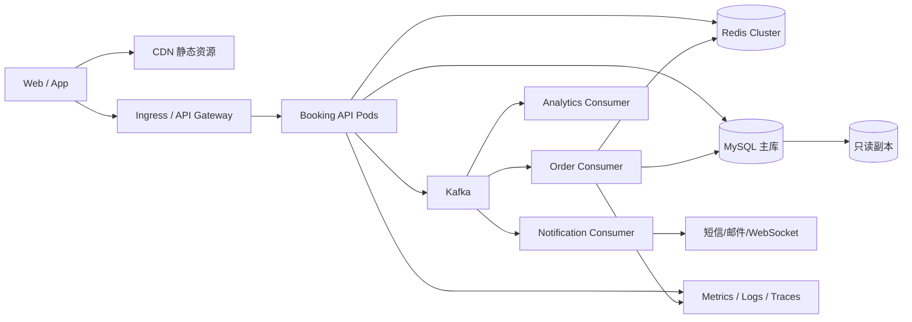

# 07 系统设计与演进路线

## 1. 系统设计的答题顺序

面试时不要一开始就画微服务。按下面顺序展开：

1. 明确功能需求和非功能需求。
2. 做数量级和峰值估算。
3. 定义核心 API、数据模型和状态机。
4. 画最小可行架构和关键请求链路。
5. 深挖一致性、并发、可用性和故障恢复。
6. 找单点与瓶颈，按规模逐步演进。
7. 给出监控、SLO、安全和成本取舍。

## 2. 需求边界

核心功能：

- 活动与场次浏览；
- 限量预约、支付、取消；
- 超时释放；
- 入场核销；
- 运营管理与统计。

非功能目标示例：

- 热门活动开始时承受突发流量；
- 不超卖、同一用户不重复预约；
- 核心查询降级时仍可用；
- 最终预约结果可追踪、可补偿；
- 可水平扩展并观测 P95/P99。

先问清库存一致性是否允许短暂延迟、预约是否必须同步确认、支付时限和跨地域需求，这些决定架构。

## 3. 目标架构



普通流量可以直接同步写 MySQL；热门活动通过功能开关进入 Redis + Kafka 链路。不要让所有业务都为峰值复杂度买单。

## 4. 查询链路扩展

阶段一：MySQL + 索引 + 分页。

阶段二：Redis 缓存热点活动，CDN 缓存公开图片和静态内容。

阶段三：读写分离。注意复制延迟：用户刚创建预约后立即查询，应读主库或使用“读己之写”策略。

阶段四：复杂搜索独立到 Elasticsearch/OpenSearch。数据库仍是事实源，通过 Kafka/CDC 更新搜索索引，并接受短暂延迟。

## 5. 写链路扩展

阶段一：MySQL 条件更新库存 + 本地事务，足以应对普通流量。

阶段二：Redis Lua 发放热门资格，Kafka 异步落单。

阶段三：按场次/用户拆分消费者，批量写入；优化索引、连接池和日志。

阶段四：单库容量或写吞吐真正达到瓶颈后再分库分表。

分片键候选：

- `user_id`：用户查询方便，但同一场次库存跨分片困难；
- `session_id`：场次内一致性方便，但用户订单列表需要聚合；
- 预约 ID：分布均匀，但业务查询需要二级索引或路由表。

没有完美分片键，应由最重要的访问模式决定。

## 6. ID 设计

数据库自增 ID 简单，但分库后不方便。可选：雪花算法、号段服务、数据库 sequence。业务还需要不可猜或可展示的 `reservation_no`。

ID 系统要考虑：全局唯一、趋势递增、时钟回拨、可用性和信息泄漏。外部接口不一定直接暴露内部主键。

## 7. 一致性模型

### 强一致部分

- MySQL 中预约单和明细的本地事务；
- 唯一索引防止重复预约；
- 库存条件更新防止负数。

### 最终一致部分

- Redis 预扣与 MySQL 最终库存；
- 预约成功后的通知；
- 搜索索引和统计报表；
- 缓存内容。

用事件、幂等、重试、补偿和对账实现最终一致。对账任务应比较 Redis 发放资格、Kafka 事件、MySQL 预约单和库存流水。

## 8. 库存流水

仅保存一个库存数字难以审计。建议增加不可变流水：

```text
inventory_ledger
- event_id
- session_id
- reservation_no
- change_type: LOCK/CONFIRM/RELEASE/REFUND
- quantity
- before_value / after_value（可选）
- create_time
```

流水便于对账、重放和解释库存变化。高吞吐下可以异步生成审计流水，但关键幂等键必须保留。

## 9. 高可用与容灾

应用：多 Pod、跨故障域、反亲和、PodDisruptionBudget、滚动升级。

MySQL：主从/集群、自动备份、时间点恢复、定期恢复演练。

Redis：主从/Cluster、持久化策略、故障降级和缓存重建。

Kafka：多 Broker、多副本、合理 ISR、跨集群备份视业务需要。

必须定义：

- RTO：故障后多快恢复；
- RPO：最多允许丢失多少数据；
- SLO：可用性和延迟目标；
- 错误预算：允许多长时间不达标。

个人项目可以通过故障注入演示，不需要声称达到真实金融级容灾。

## 10. 降级策略

当依赖异常时：

- 活动详情：返回短期陈旧缓存或静态降级页；
- 热门预约：停止发放新资格，返回“系统繁忙”，不要直接穿透 MySQL；
- Kafka 积压：保留预约核心消费者，暂停报表/推荐等非核心消费者；
- 通知失败：不回滚已成功预约，进入重试和人工补发；
- 报表不可用：不影响预约主链路。

系统设计亮点是明确“哪些功能可以牺牲，哪些数据绝不能错”。

## 11. 安全设计

- JWT/会话认证和角色权限；
- 数据归属校验，防止水平越权；
- 网关与业务双层限流；
- 参数校验、SQL 预编译、防 XSS/CSRF（依客户端形态）；
- 核销码短期有效、一次使用、不可顺序猜测；
- 敏感数据加密/脱敏和访问审计；
- Secret 管理、TLS、镜像与依赖漏洞扫描；
- 支付/第三方回调验签、验金额、幂等和防重放。

## 12. 演进路线

### V1：正确的模块化单体

Spring Boot + MyBatis + MySQL；状态机、事务、唯一索引、自动化测试。

### V2：热点治理

Redis 缓存、库存 Lua、限流、幂等，补齐监控和压测。

### V3：事件驱动

Kafka 异步落单、通知、报表；重试、死信、对账。

### V4：云原生交付

Docker、K8s、探针、HPA、Prometheus/Grafana、灰度和故障演练。

### V5：规模化拆分

只有团队规模、发布频率或容量证明有必要时，才拆活动、库存、预约、核销、通知服务；随后考虑读写分离、搜索和分片。

面试亮点：你知道如何扩展，也知道什么时候不该扩展。

## 13. 未来优化清单

按优先级：

1. 修复当前正确性问题，补测试和数据库迁移。
2. 建立 SLI/SLO 和真实压测基线。
3. 优化 N+1、慢 SQL、连接池和缓存策略。
4. 实现热门预约的 Redis Lua 与幂等。
5. 引入 Kafka 并完成失败恢复、对账和积压治理。
6. 容器化、可观测性、K8s 弹性及故障演练。
7. 根据瓶颈证据决定是否读写分离、搜索、分库分表或微服务。

